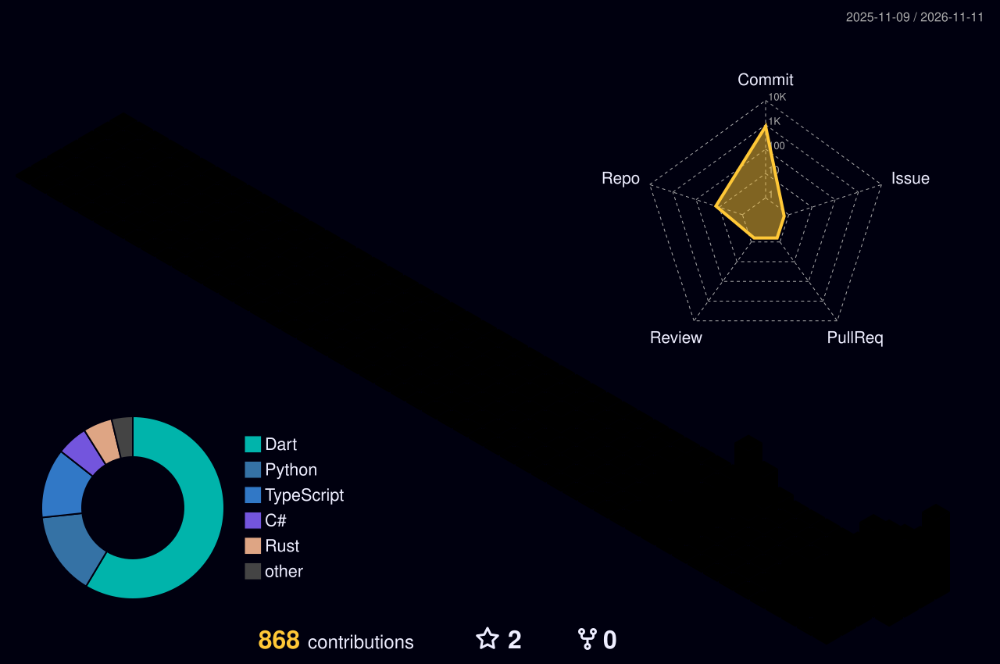

  

    <!--START_SECTION:toplang--><!--END_SECTION:toplang-->

---

## Latest Projects

> Auto-updated every 6 hours by GitHub Actions, based on the repos I last pushed.

<!--START_SECTION:repos-->
<table>
<tr>
<td align="center" width="33%">
<b><a href="https://github.com/nekonaru/rynnbot">rynnbot</a></b> 
Jalankan bot WhatsApp milikmu sendiri dengan ratusan perintah, game, perkakas AI, CLI i...  
  
Updated 13 Nov 2026
</td>
<td align="center" width="33%">
<b><a href="https://github.com/nekonaru/rentra">rentra</a></b> 
Ubah pertanyaan ketersediaan menjadi satu link booking publik dengan kalender ketersedi...  
  
Updated 13 Nov 2026
</td>
<td align="center" width="33%">
<b><a href="https://github.com/nekonaru/stashify">stashify</a></b> 
Stashify finds songs from your Spotify library on YouTube and saves them locally with c...  
  
Updated 13 Nov 2026
</td>
</tr>
</table>
<!--END_SECTION:repos-->

---

## Tech Stack

---

## GitHub Stats

---

## Connect

