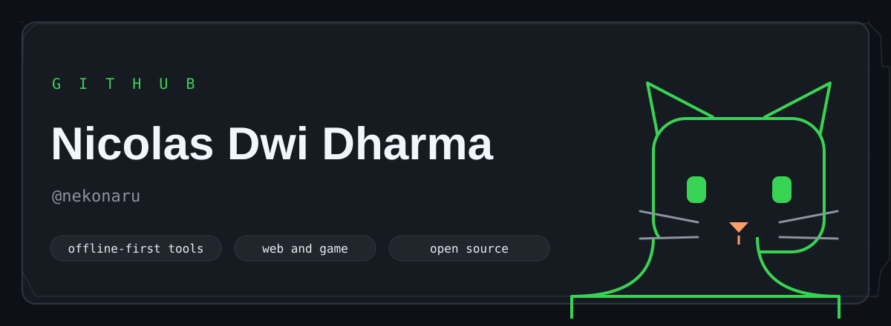

  

    <!--START_SECTION:toplang--><!--END_SECTION:toplang-->

> Auto-updated every 6 hours by GitHub Actions, based on the repos I last pushed.

<!--START_SECTION:repos-->
<table>
<tr>
<td align="center" width="33%">
<b><a href="https://github.com/nekonaru/rynnbot">rynnbot</a></b> 
Jalankan bot WhatsApp milikmu sendiri dengan ratusan perintah, game, perkakas AI, CLI i...  
  
Updated 19 Nov 2026
</td>
<td align="center" width="33%">
<b><a href="https://github.com/nekonaru/swara">swara</a></b> 
Play your music collection offline with automatic metadata, synced lyrics, playlists, a...  
  
Updated 19 Nov 2026
</td>
<td align="center" width="33%">
<b><a href="https://github.com/nekonaru/cache22">cache22</a></b> 
One-time secret links that burn after reading, with end-to-end encryption. The server o...  
  
Updated 19 Nov 2026
</td>
</tr>
</table>
<!--END_SECTION:repos-->

