

  

    <!--START_SECTION:toplang--><!--END_SECTION:toplang-->

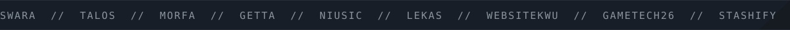

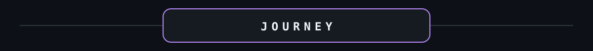

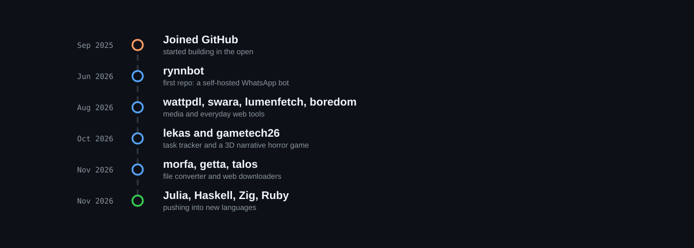

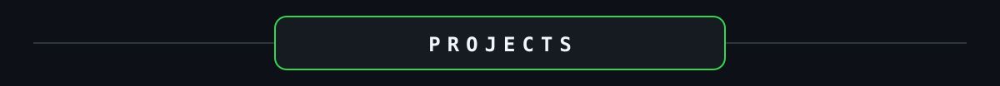

> Auto-updated every 6 hours by GitHub Actions, based on the repos I last pushed.

<!--START_SECTION:repos-->
<table>
<tr>
<td align="center" width="33%">
<b><a href="https://github.com/nekonaru/koe">koe</a></b> 
Transcribe audio and video to text in your browser, free and unlimited. Fully private a...  
  
Updated 19 Nov 2026
</td>
<td align="center" width="33%">
<b><a href="https://github.com/nekonaru/wattpdl">wattpdl</a></b> 
Download Wattpad stories as offline .txt, .docx, .epub, .md, or .pdf files, whole or ch...  
  
Updated 19 Nov 2026
</td>
<td align="center" width="33%">
<b><a href="https://github.com/nekonaru/kalkulasa">kalkulasa</a></b> 
Urusi stok dan kas warung harian dengan kasir satu ketuk, modal per barang otomatis, da...  
  
Updated 19 Nov 2026
</td>
</tr>
</table>
<!--END_SECTION:repos-->

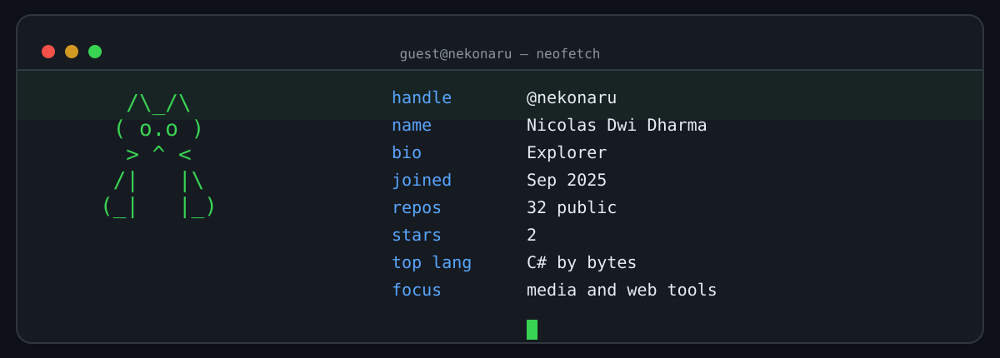

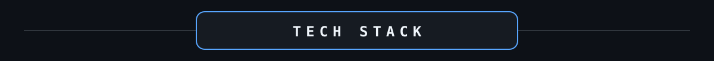

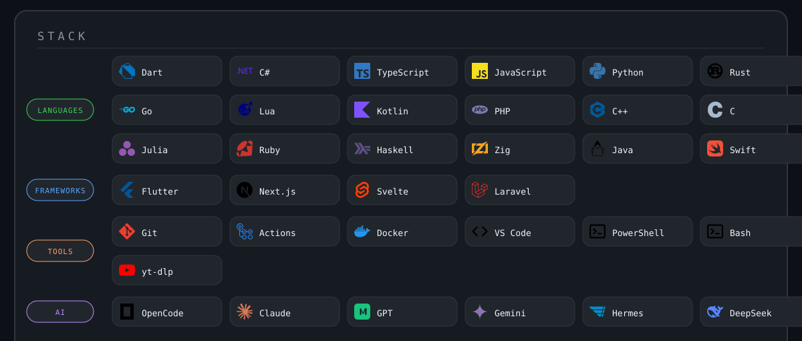

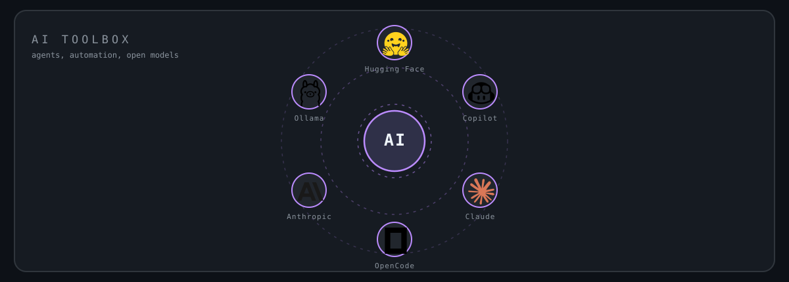




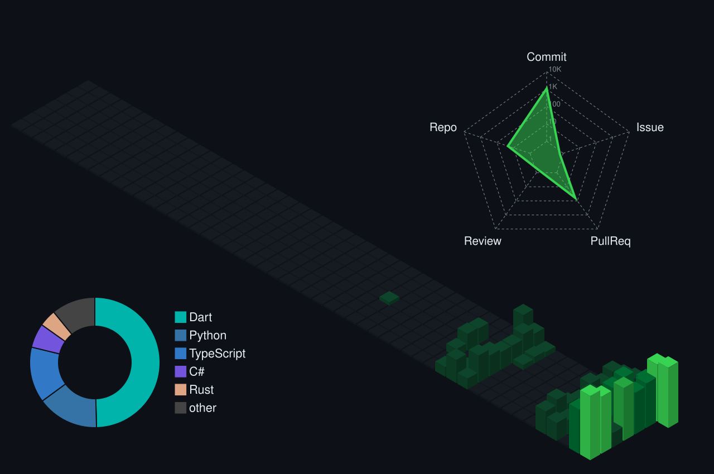


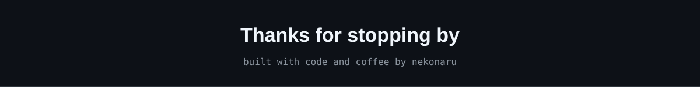
